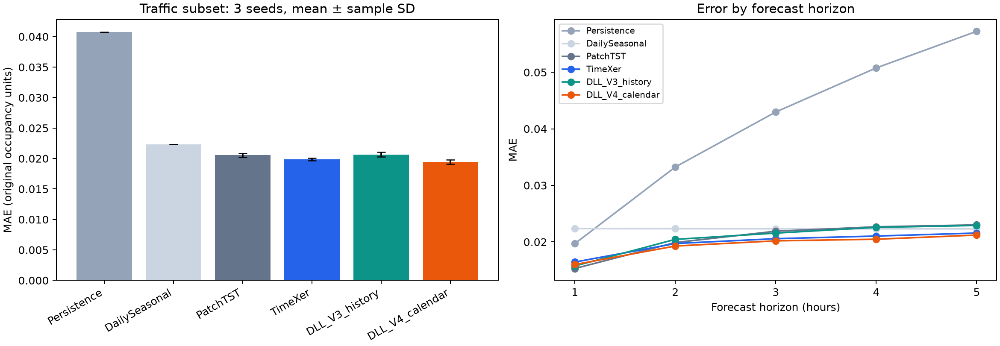

# DLL-TimeXer 初步真实数据效果测试

日期：2026-11-02。本次不使用合成数据评价效果。代码基线为独立仓库初版 `8ae0bd4`，模型实现未按测试集结果调参。

## 协议

- 数据：本地已有 Traffic（17,544 行、原始862个传感器的小时数据）；固定选0–3为4个目标，4–15为12个辅助变量。不是全862传感器基准，也不是网约车数据。
- 划分：按时间70%训练、15%验证、15%测试；标准化只拟合训练段。所有模型预测完全相同的测试窗口，标签不跨分区。此划分与部分论文采用的70/10/20不同，不直接比较论文数字。
- 任务：历史48小时 → 未来1–5小时，共2,628个测试窗口。误差使用原始占用率量纲，跨目标/步长均匀平均。
- 训练：每个模型完整训练5轮；随机种子[2021, 2022, 2023]；batch=64，Adam，lr=0.001，CPU单线程。每轮完整验证，按验证MSE选最佳checkpoint，最终评估完整测试集。没有使用max-steps截断。
- 宽度16、2个heads、1层、dropout=0.1、patch=4。PatchTST stride=2，其余patch不重叠。DLL有8个lag，每个辅助窗口8步，相关性窗口16步。参数量与计算量不完全相等。
- DLL_V3_history与TimeXer使用相同目标/辅助历史，不加未来/静态上下文；DLL_V4_calendar额外使用预测时刻已知的未来小时/星期sin-cos特征。没有使用未来实测传感器值或静态区域属性。
- Persistence重复最后一个观测值；DailySeasonal重复24小时前对应位置，所有基线输入均在历史窗口内。

## 结果

| 模型 | MAE（均值 ± SD） | RMSE（均值 ± SD） | 参数量 | 每次完整运行秒数 |
|---|---:|---:|---:|---:|
| Persistence | 0.040787 | 0.074132 | 0 | — |
| DailySeasonal | 0.022329 | 0.050380 | 0 | — |
| PatchTST | 0.020554 ± 0.000317 | 0.040235 ± 0.000316 | 5,670 | 17.0 |
| TimeXer | 0.019868 ± 0.000241 | 0.038605 ± 0.000108 | 6,389 | 27.8 |
| DLL_V3_history | 0.020651 ± 0.000373 | 0.039998 ± 0.000215 | 6,873 | 30.8 |
| DLL_V4_calendar | 0.019430 ± 0.000345 | 0.037741 ± 0.000281 | 6,953 | 30.5 |

均值/SD跨3个随机种子计算；每次运行秒数包含训练、验证与最终测试，不是单样本推理时延。不同seed的预测误差有相关性，3个seed不能作为充分显著性检验。



## 数值比较

- DLL历史版相对TimeXer：MAE变化 +3.94%，RMSE变化 +3.61%。负值表示误差降低。
- DLL日历版相对TimeXer：MAE变化 -2.20%，RMSE变化 -2.24%。
- DLL日历版相对PatchTST：MAE变化 -5.47%，RMSE变化 -6.20%。
- DLL日历版相对DLL历史版：MAE变化 -5.91%。两者同时改变上下文开关和输入，不能将差异解释为某一个模块的单独贡献。

## 按步长MAE

| 模型 | 1小时 | 2小时 | 3小时 | 4小时 | 5小时 |
|---|---:|---:|---:|---:|---:|
| Persistence | 0.019703 | 0.033253 | 0.042976 | 0.050765 | 0.057240 |
| DailySeasonal | 0.022353 | 0.022337 | 0.022322 | 0.022317 | 0.022314 |
| PatchTST | 0.015300 | 0.019889 | 0.021895 | 0.022673 | 0.023013 |
| TimeXer | 0.016441 | 0.019719 | 0.020572 | 0.021038 | 0.021568 |
| DLL_V3_history | 0.015751 | 0.020453 | 0.021562 | 0.022572 | 0.022914 |
| DLL_V4_calendar | 0.016001 | 0.019275 | 0.020189 | 0.020476 | 0.021207 |

## 修正分支诊断

日历版3个seed的gamma从初始0.01训练到约0.157–0.164，辅助修正分支确实参与输出。历史版和日历版的相关性beta也有更新，但这不能单独证明该模块改善了泛化。
对日历版已训练checkpoint把修正量移除后，基础分支MAE分别约0.02663、0.03640、0.05544，均高于完整模型。因此“可以退化到基础分支”目前是功能保证，不是缺失外生输入时的准确率保证。共同训练后基础分支可能与辅助分支相互补偿；这不是重新训练的target-only消融。后续可在验证集上研究基础分支辅助监督/缺失训练，不能用测试结果直接调参。
完整诊断数值见 `diagnostics.json`。本次不修改模型以追赶测试集指标。

## 解释边界

本轮回答“模型能否训练、在固定真实数据任务上的初步效果如何”，不证明业务收益或因果关系。固定前16个传感器没有保证地理关系或最大可预测相关；不依据测试结果重新挑选传感器。相邻预测窗口重叠，不把每个窗口当独立样本做显著性结论。

尚需真实网约车数据、更多传感器子集、验证集超参数搜索、V0–V4逐模块消融、不同训练预算和高峰/异常场景评估。不能仅凭本轮结果断言DLL在其他任务上优于或劣于TimeXer。

## 复现

```bash
python scripts/benchmark_traffic.py --csv /path/to/traffic.csv --output outputs/traffic_effect_20261102
python scripts/report_traffic.py --results outputs/traffic_effect_20261102
```

源码和精简报告提交仓库；数据、权重和完整日志保留本地。`summary.json`、`protocol.json` 和 `runs.json` 包含实际记录，可追溯每个seed及验证选中的epoch。

## MAPE / WMAPE 补充

复用固定预测补算百分比误差，未重新训练或选模。DLL日历版 MAPE 40.48%、总体WMAPE 29.14%；TimeXer分别41.22%、29.80%。日历版略优于TimeXer，但MAPE仍高于重复昨日值的35.28%。完整计算口径、零值覆盖和各seed结果见 [百分比指标报告](PERCENTAGE_METRICS.md)。
